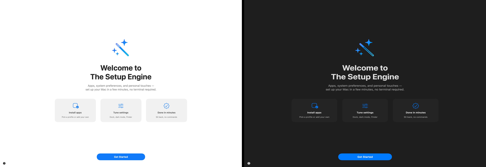
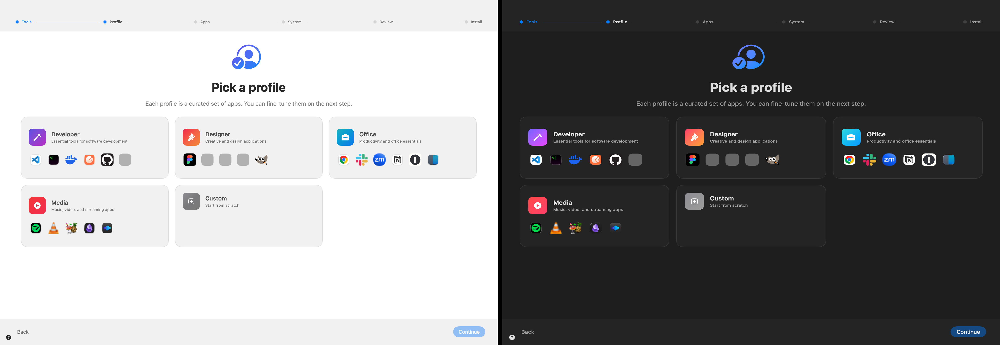
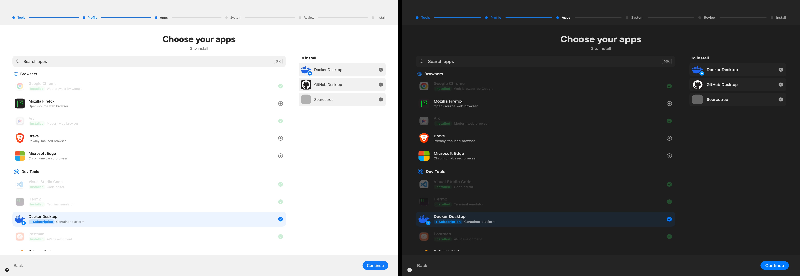
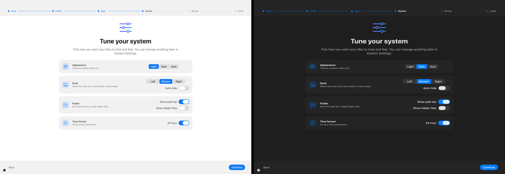
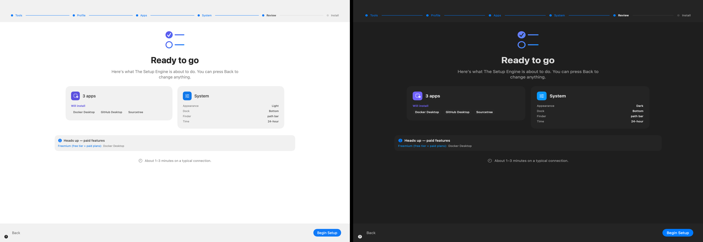

# The Setup Engine

A guided macOS setup workflow built with SwiftUI. Installs apps straight from their makers, checks each one with Apple, and configures system preferences without ever touching Terminal.



## Why

Some days I wipe my Mac multiple times. Others, not so much. Either way, I kept finding myself doing the same thing over and over — downloading the same apps I use daily, toggling the same preferences. I wanted a Mac version of [Ninite](https://ninite.com/).

What started as a shell script is now this SwiftUI app that walks anyone through the same five steps without ever touching a terminal: **Profile**, **Apps**, **System**, **Review**, **Install**.

If you're setting up a brand new Mac — or wipe yours as often as I do — I hope it cuts the mundane out of it.

**Requirements:** macOS 14 (Sonoma) or later, Apple Silicon or Intel. No Homebrew needed for apps.

## How to use

Every screenshot below is **light on the left, dark on the right** — the app follows your system appearance.

### 1. Profile — pick a starting set



Five curated profiles: **Developer**, **Designer**, **Office**, **Media**, or **Custom** (start from scratch). Each card previews the apps it'll bring in. Nothing's installed yet — this is just a starting point.

### 2. Apps — fine-tune the list



The full catalogue, grouped by category. Already-installed apps are greyed out with a green check (the app reads `/Applications` and `~/Applications`). Apps in your queue go to the **To install** rail on the right. Paid/freemium apps get a small badge so you know what you're committing to, and apps that can't run on this Mac (say, Apple Silicon only on an Intel Mac) say why. **⌘K** searches Homebrew's whole catalog of about 5,000 apps from anywhere.

### 3. System — tune preferences



Dock position + auto-hide, system appearance (Light / Dark / Auto), Finder path bar + hidden files, 24-hour time. Everything here is a `defaults write` + `killall Dock`/`killall Finder` under the hood — non-destructive and trivially reversible from System Settings.

### 4. Review — confirm everything



A summary of what's about to happen — apps to install, settings to change, and a heads-up if anything in the queue is paid/freemium. Hit **Begin Setup** to actually run it, or **Back** to change anything.

### 5. Install

Staged progress with a clean "what's happening now" tile: downloading, checking with Apple, installing. Apps that use Apple's installer (Zoom, Microsoft Teams) are installed together behind one password prompt at the end. No raw terminal output — that goes to a log file you can pull up via **File → Collect Diagnostic Logs… (⌘⇧L)**.

## Diagnostics

The floating **?** button (bottom-left of every screen) and the **File** menu both expose:

- **Collect Diagnostic Logs… (⌘⇧L)** — bundles the three log files into one timestamped `.txt` and reveals it in Finder.
- **Reveal Logs in Finder** — opens the logs directory.
- **Save Window Snapshot to Desktop (⌘⇧S)** — captures the current window as a PNG. (How the screenshots in this README were made.)

Three logs exist after a setup run:

| Path | Contents |
|---|---|
| `~/Library/Application Support/TheSetupEngine/Logs/setup-engine.log` | App-level structured log (categories: catalog, install, homebrew, settings, ui) |
| `~/Library/Application Support/TheSetupEngine/Logs/admin.log` | Output of the one `osascript with administrator privileges` run (installer packages, Homebrew) |
| `~/Library/Application Support/TheSetupEngine/Logs/install.log` | `brew install` output for command-line tools |

## Build & run

```bash
git clone https://github.com/jamieal/The-Setup-Engine.git
cd "The-Setup-Engine"
open "The Setup Engine.xcodeproj"
```

Then ⌘R in Xcode. The Debug build adds a hidden Debug menu (simulate failures, jump between steps).

To build a Release `.dmg` for sharing:

```bash
./scripts/release.sh
# → build/The Setup Engine.dmg
```

If you have an Apple Developer account, set `DEVELOPMENT_TEAM`, `APPLE_ID`, and `NOTARY_PASSWORD` env vars and the same script will sign + notarize.

## How apps get installed

The Setup Engine installs apps the way IT tools like [Installomator](https://github.com/Installomator/Installomator) do, straight from each maker's download, but without hand-maintained links. It reads [Homebrew's public app catalog](https://formulae.brew.sh/docs/api/), which Homebrew's community keeps current, for each app's download link, version and checksum. Homebrew itself isn't needed.

For each app:

1. Download it from the maker (the Intel or Apple Silicon build, as appropriate).
2. Check the file against the catalog's SHA-256 checksum. A few makers (Chrome, Spotify) publish none, so step 4 carries those.
3. Unpack it: disk image, zip, tarball or installer package.
4. Ask Gatekeeper (`spctl --assess`) whether Apple trusts it: Developer ID signed and notarized. Anything Apple won't vouch for isn't installed.
5. Move the app into `/Applications`. No password needed for an admin account. Installer packages run with `installer` behind a single password prompt.

**Homebrew is only used for command-line tools.** If you pick any and Homebrew is missing, the app installs it with Homebrew's official, notarized installer package (Apple Silicon, macOS 15+). Homebrew no longer installs on Intel Macs, so there command-line tools need an existing Homebrew.

The catalog is cached in `~/Library/Caches/TheSetupEngine/` and refreshed with an ETag. A snapshot of the curated apps ships in the app (`CatalogSnapshot.json`) so the first launch works offline. A weekly GitHub Action (`.github/workflows/catalog-check.yml`) flags any curated app Homebrew deprecates or disables, and opens a PR refreshing the snapshot (`scripts/update-catalog-snapshot.py`).

## Architecture

Single-target SwiftUI app. No Swift Package dependencies.

- **`SetupCoordinator`** — `ObservableObject` state machine. One step enum, one navigation method, all state lives here.
- **`SetupContainerView`** — header (progress track), body (current step), footer (Back / Continue), ⌘K overlay, floating ? button.
- **Step views** — `WelcomeStep`, `ProfileStep`, `AppsStep`, `SystemStep`, `ReviewStep`, `InstallStep`, `DoneStep`.
- **`CaskCatalog`** — loads, caches and searches Homebrew's app catalog; resolves each app's download for this Mac's chip and macOS.
- **`DirectInstaller`** — download → checksum → unpack → Gatekeeper → move into Applications.
- **`HomebrewSupport`** — installs Homebrew (official .pkg) and formulae, only for command-line tools.
- **`MacEnvironment`** — chip, macOS version and codename.
- **`ShellRunner`** — async shell exec with non-blocking termination handling. `runWithAdmin` uses `osascript … with administrator privileges` for the one password prompt.
- **`AppLog`** — lightweight logger; mirrors to `~/Library/Application Support/TheSetupEngine/Logs/`.
- **`AppVersion`** — single source of truth for version strings, read from Info.plist.
- **`WindowSnapshot`** — in-app self-screenshot via `NSView.cacheDisplay`, no Screen Recording permission required.
- **`IconPrewarm`** — bumps `URLCache.shared` to 30 MB and pre-fetches every cask icon URL on app launch so Profile/Apps cards render with their icons populated instead of blank squares.
- **`DebugState`** — runtime debug overrides (`#if DEBUG` gated). Toggleable from a menu bar item; also reads `TSE_FAKE_APP_FAILURES=n` from the environment.

## Safety notes

Most apps install with no password at all. Only installer packages (and Homebrew, if needed) run as root, together, via `osascript with administrator privileges`. That root script:

- Only runs `installer -pkg` on packages Gatekeeper has already accepted, and `ditto` into `/Applications`
- Quotes every path, and is written to the user's private temp folder (not shared `/tmp`)
- Logs everything it does to `~/Library/Application Support/TheSetupEngine/Logs/admin.log`

The system preferences step uses `defaults write` and `killall Dock` / `killall Finder` — all non-destructive and reversible from System Settings.

## Status

- **Apple Silicon and Intel** (universal build). Command-line tools on Intel need an existing Homebrew.
- **macOS 14 (Sonoma)+**. Individual apps may need newer; the app says so.
- Built and signed ad-hoc. No notarization yet — that requires an Apple Developer Program membership.
- Single-developer side project. Not a polished product. PRs and issues welcome.

## License

MIT.
